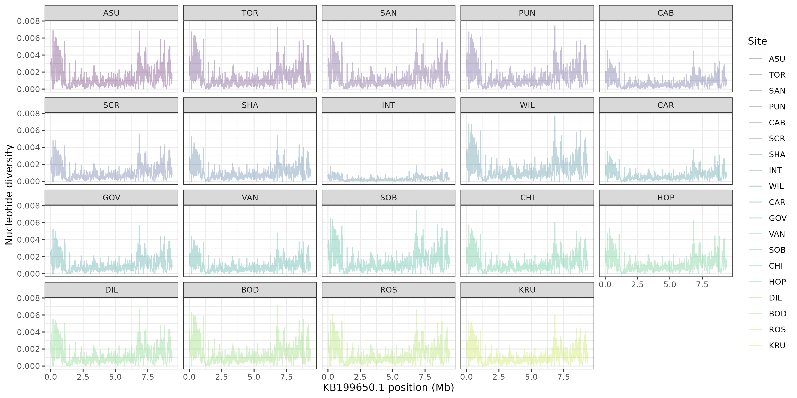
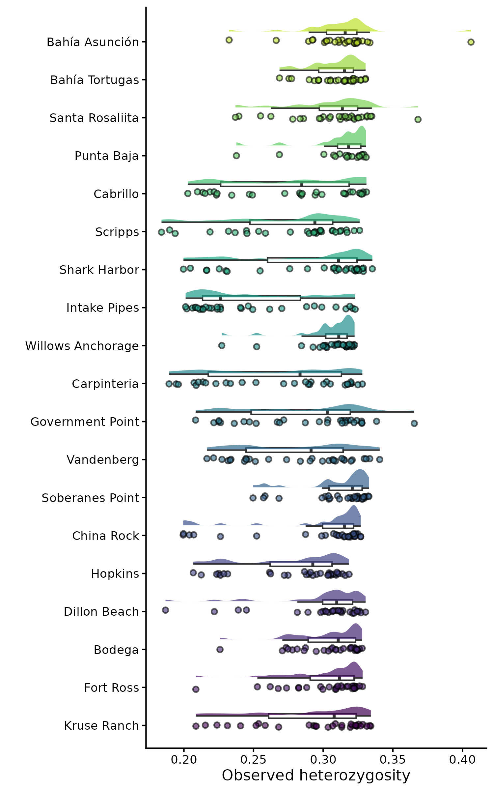
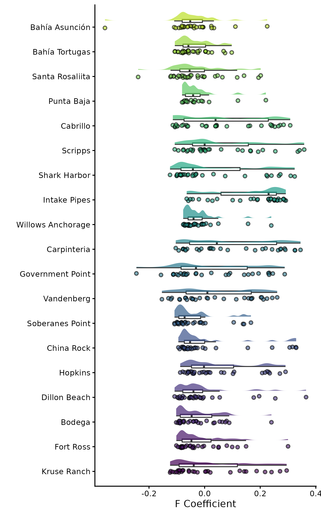
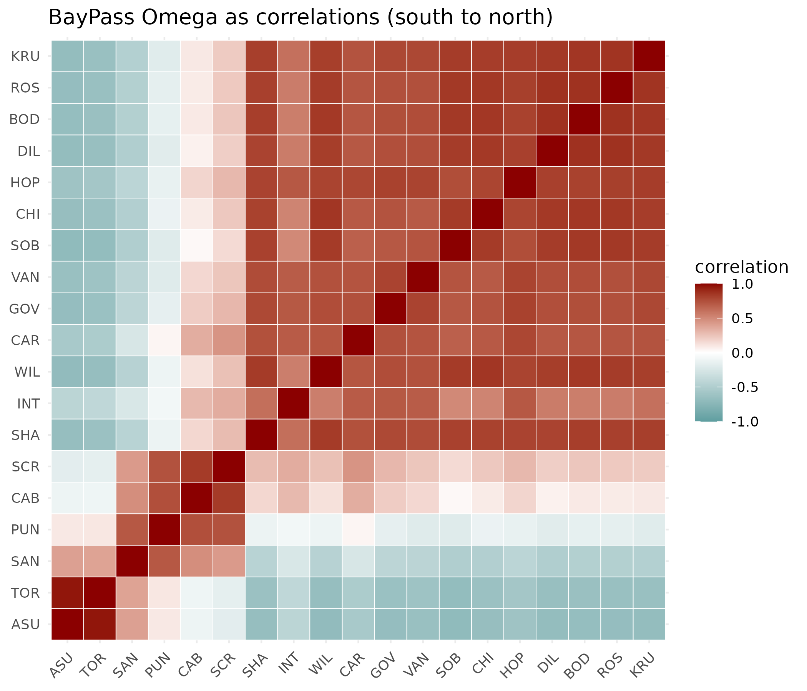
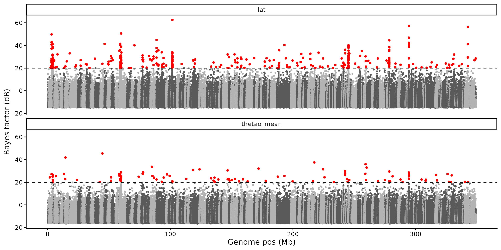
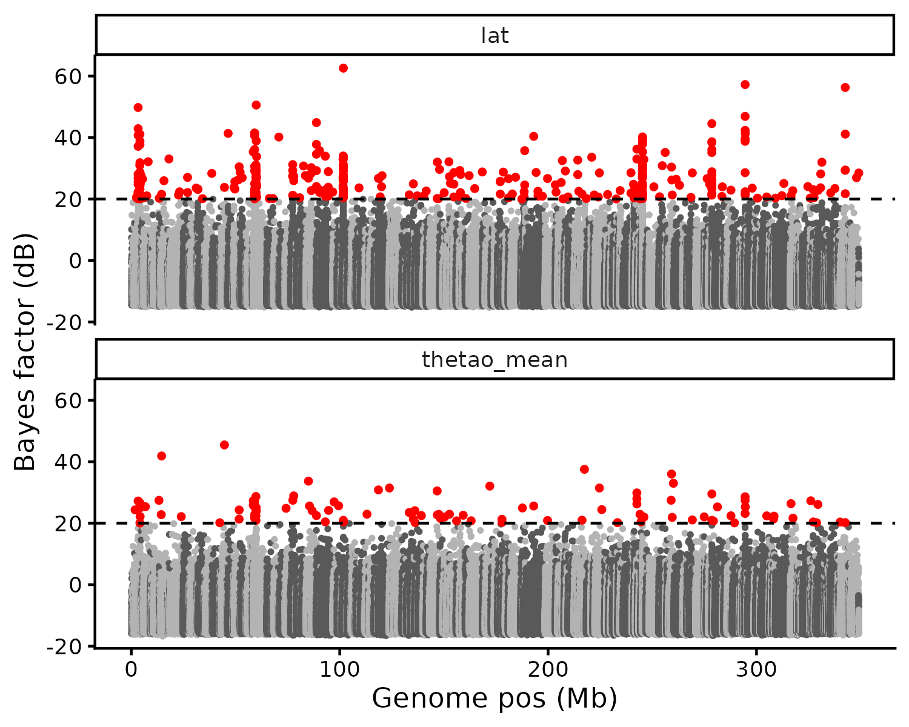

# Population Genomics Notebook

### 10/13/2026 - Day 1 of population genomics

utilizing VCF (Variant Call Format) to access genome data for *Lottia gigantea* (the owl limpet). Worked in terminal to copy files from the VACC.

Module load

-   gcc

-   bcftools v1.19

use —version to get the version you are using

use -h to get the manual (-h = get help)

### 10/15/2026 - Day 2 of population genomics

worked on copying over some big files and working on our first batch job.

created this batch job file `~/projects/eco_genomics_2026/population_genomics/myscripts/vcf_stats.sh`

### 10/20/2026 - Day 3 of population genomics

Understand LD, utilize `plink`, and plot. Run admixture and interpret plots

copied a number of files into my `mydata` folder

set a data directory

`DATA_DIR=~/projects/eco_genomics_2026/population_genomics/mydata`

my path \`/users/s/i/siwinski/projects/eco_genomics_2026/population_genomics/mydata\`

```{bash}
echo $DATA_DIR/$VCF
cd $DATA_DIR
```

Version of plink we are using: PLINK v1.9.0-b.7.7 64-bit (22 Oct 2024)

Ran the PCA in terminal

Switched back to R to plot the PCA

added figures to `~/projects/eco_genomics_2026/population_genomics/myresults`

Scree Plot: lets see how much of the variation each PC explains. This helps us decide how many PCs are worth looking at.

{width="523"}

The PCA plot

{width="541"}

noticed a some sort of pattern happening with latitude, wanted to look into it further.

Plot PC1 and PC2 against latitude

{width="564"}

Bonus: a map of our sites

{width="626"}

cross-validation error plot

{width="577"}

Look for the K with the lowest CV error, or the point where the curve flattens out.

-   three has the lowest error here, want to look into that further. we will be plotting all five.

Admixture plot K1-5


seems like the PCA and admixture support each other. Using this as a gauge as to how many populations we have.

K=5 has way to much noise, and error.

Could select K=2 or 3

its not to say that there aren't 3 distinct populations, but we can see the right two populations are distinctly different from the rest of the groups in all 5 admixtures. Those two on the right are the southernmost groups. What drives them? Could it be temperature?

Those two are in an area where there is a lot of up-welling and is a bit colder than one of the populations slightly north. There might not be a lot of dispersion jut because of geography.

Worked on another batch job to end class

### 10/22/2026 - Day 4 of population genomics

explain nucleotide diversity, heterozygosity, and compare

vcftools version: vcftools/0.1.16

my full directory `/users/s/i/siwinski/projects/eco_genomics_2026/population_genomics/mydata`

Read pi files, joined them together, and produced a pi data frame

vcftools is a bit biased when it comes to calculating pi. We now often use things like pixie, but they are a lot of work and effort to deal with. vcftools gives us a good overview look.

pi plot on genetic diversity

{width="517"}

plot using pi vs latitude

{width="520"}

### 10/27/2026 - Day 5 of population genomics

continued to work on genetic diversity, diversity along the genome, Tajima's D, heterozygosity.

R script added to `~/projects/eco_genomics_2026/population_genomics/myscripts/geneticdiversity.R`

Created a plot looking at the genome, looking at one site. Look at how π varies along one scaffold. Picked the scaffold with the most windows:


Facet graph looking at all of the different scaffolds

{width="588"}

High diversity - gives variety and it could be conditionally beneficical to have this much diversity

*INT* looks interesting because it has a lot less diversity at that site then all of the other graphs and other sites.

**Tajima's D** - compares two estimates of genetic diversity to test for divergence from neutrality across the genome

{width="353"}

similar code to look at how Tajima's D is spread across the genome. If Tajima's D is very negative in an area there could be a lot of positive selection happening in that area of the genome. What is that area related to? maybe thermal tolerance or etc?

Heterozygosity

-   **Observed heterozygosity** (HO) is the proportion of sites at which an individual is heterozygous.

-   **Expected heterozygosity** (HE) is the proportion we would expect if the population mated at random (Hardy–Weinberg equilibrium): 2pq at each site, where p and q are the allele frequencies.

-   **The inbreeding coefficient** compares the two: F = 1 − HO / HE. F = 0 means an individual is as heterozygous as expected, F \> 0 means less heterozygous, and F \< 0 means more.

Using `ggdist` to make a rain cloud plot

{width="449"}

Seeing more/higher heterozygosity at the highest and lowest ends of the latitudes/locations.

looking at inbreeding coefficient. Comparing expected and observed heterozygosity.

{width="324"}

-F means not very inbred, more rare alleles than expected . +F means less rare alleles than expected meaning more inbreeding.

**Signatures of Selection**

created `~/projects/eco_genomics_2026/population_genomics/myscripts/selective_sweeps.R`

F~ST~ is the fixation index, measuring how different each sub population is from each other. Asks how much of the total genetic variation is due to differences between populations. 0 means that they are very similar with complete overlap. 1 means that they are completely distinct populations.

Worked in terminal for a little while here.

used VCFtools to do pairwise comparison

Weir and Cockerham mean Fst estimate: 0.016245, Weir and Cockerham weighted Fst estimate: 0.020162

Back in R - Full Path: `/users/s/i/siwinski/projects/eco_genomics_2026/population_genomics/myresults`

created a genome-wide pairwise FST table

{width="643"}

ASU and TOR are the two populations that are the southernmost populations that seem to be a bit more different than the rest of the populations. there seems to be a gradient in the graph, the core population being in that top right area.

isolation by distance graph. Using the latitude to plot the FST again

{width="524"}

There does seem to be some isolation by distance over this population. It is noisy, but we are seeing a trend.

Back in terminal we are scanning the genome in windows.

had to edit this head command in terminal

```{bash}
head fst/${POP1}_vs_${POP2}_FST_10kb.windowed.weir.fst
```

### 10/29/2026 - Day 6 of population genomics

BayPass - can tackle three populations as the same times. uses Bayesian analysis to run genome scans.

(Omega): the (scaled) covariance matrix of allele frequencies among the populations.

There is a lot of analysis that took a lot of time to run that was done previous to our working with the data in class today. It was run as a batch job. Information about the code and the batch job that was performed can be found in the Signatures of Selection tutorial in section four about BayPass.

Grabbed some data from the class folder for the BayPass using terminal

Made a new R script for baypass `~/projects/eco_genomics_2026/population_genomics/myscripts`

Populations clustered by BayPass Omega

{width="519"}

BayPass Omega as correlations visualized

{width="487"}

core of the population is that red area in the top right section of the graph. Seems like we might have three different populations here, even though we have sampled at 19 sights. Seems like we have accounted for that neutral population structure and are now looking at the areas that are focused on selection.

BayPass gives you two directions of this sort of p-value because it is looking for balancing selection.

Looking at our p-value distribution

{width="363"}

There are a lot of p-values around zero which is surprising.

{width="527"}

Manhattan plot\
xtx is just looking across everything this next plot is looking it against environment.

{width="435"}

correlation with latitude and sea surface temperature

then repeated it with latitude

{width="400"}

what do these patterns suggest

-   the graph above has a strong association with latitude, which is interesting to look into. Supposedly this SNP is standing outside of the omega matrix, this is greater than what we would expect from neutral pop structure

-   you would want it to be a negative slope, or a relationship across the sites with temperature for there to be something going on with sea surface temperature. (flat graph that is not visualized here but was seen in class. They all had .75)

<!-- -->

-   Change and pull out the counts to change the top snp and to change which one is being visualized on the graph.

BayPass is really good at accounting for multiple variables in analysis.
