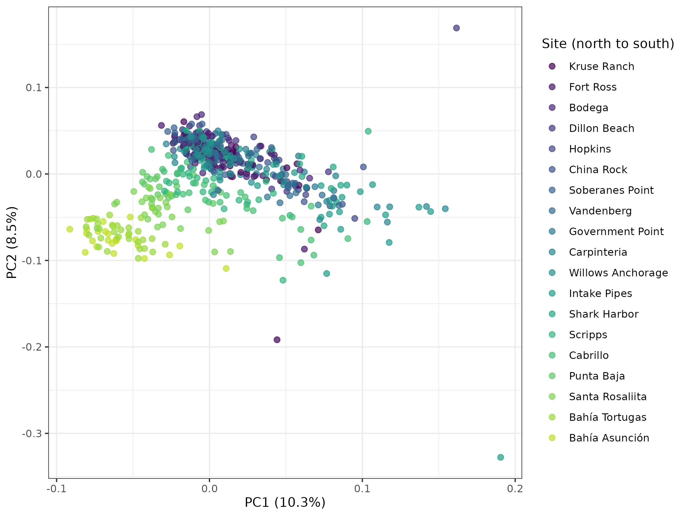
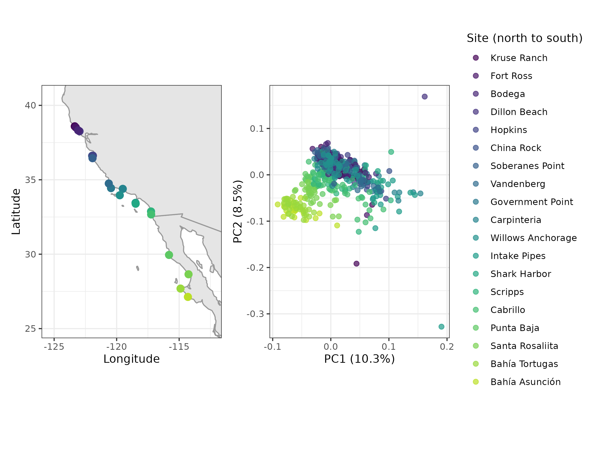

# Population Genomics Notebook

### 10/13/2026 - Day 1 of population genomics

utilizing VCF (Variant Call Format) to access genome data for *Lottia gigantea* (the owl limpet). Worked in terminal to copy files from the VACC.

Module load

-   gcc

-   bcftools v1.19

use —version to get the version you are using

use -h to get the manual (-h = get help)

### 10/15/2026 - Day 2 of population genomics

worked on copying over some big files and working on our first batch job.

created this batch job file `~/projects/eco_genomics_2026/population_genomics/myscripts/vcf_stats.sh`

### 10/20/2026 - Day 3 of population genomics

Understand LD, utilize `plink`, and plot. Run admixture and interpret plots

copied a number of files into my `mydata` folder

set a data directory

`DATA_DIR=~/projects/eco_genomics_2026/population_genomics/mydata`

my path \`/users/s/i/siwinski/projects/eco_genomics_2026/population_genomics/mydata\`

```{bash}
echo $DATA_DIR/$VCF
cd $DATA_DIR
```

Version of plink we are using: PLINK v1.9.0-b.7.7 64-bit (22 Oct 2024)

Ran the PCA in terminal

Switched back to R to plot the PCA

added figures to `~/projects/eco_genomics_2026/population_genomics/myresults`

Scree Plot: lets see how much of the variation each PC explains. This helps us decide how many PCs are worth looking at.

{width="523"}

The PCA plot

{width="541"}

noticed a some sort of pattern happening with latitude, wanted to look into it further.

Plot PC1 and PC2 against latitude

{width="564"}

Bonus: a map of our sites

{width="626"}

cross-validation error plot

{width="577"}

Look for the K with the lowest CV error, or the point where the curve flattens out.

-   three has the lowest error here, want to look into that further. we will be plotting all five.

Admixture plot K1-5


seems like the PCA and admixture support each other. Using this as a gauge as to how many populations we have.

K=5 has way to much noise, and error.

Could select K=2 or 3

its not to say that there aren't 3 distinct populations, but we can see the right two populations are distinctly different from the rest of the groups in all 5 admixtures. Those two on the right are the southernmost groups. What drives them? Could it be temperature?

Those two are in an area where there is a lot of up-welling and is a bit colder than one of the populations slightly north. There might not be a lot of dispersion jut because of geography.

Worked on another batch job to end class
